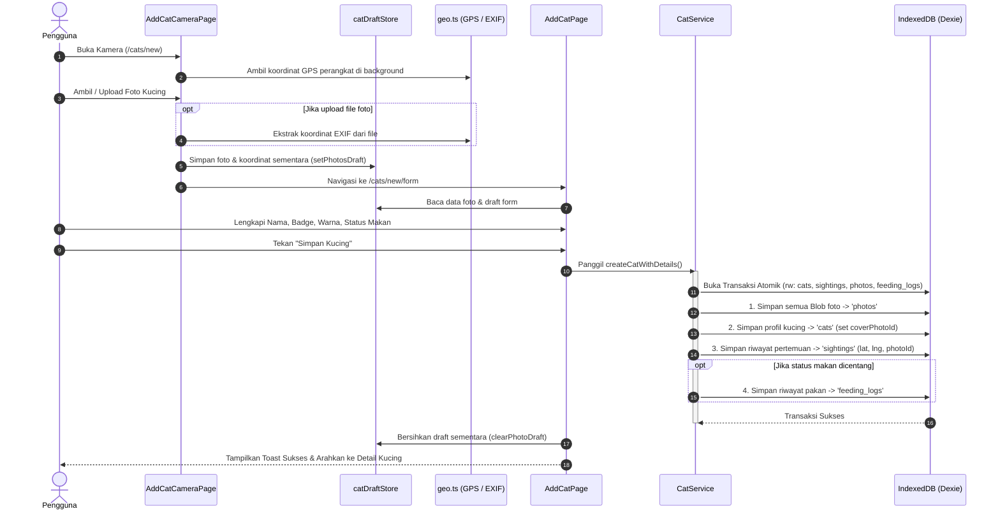
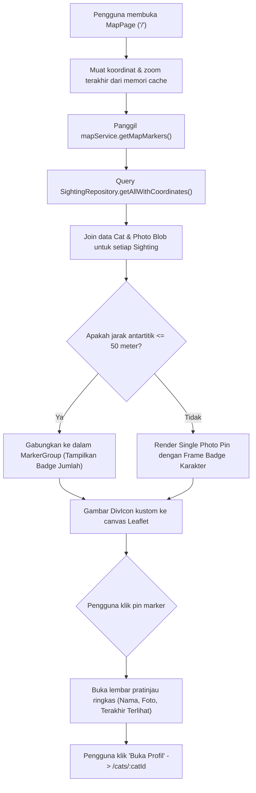
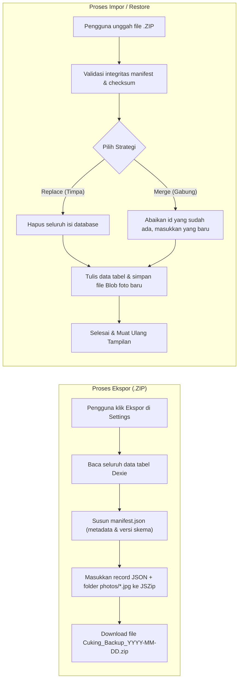

# System Architecture & Technical Specification — ProwlLog PWA (Cuking)

> **Dokumen Panduan Arsitektur & Sistem untuk AI Agent dan Pengembang**  
> Proyek: **ProwlLog PWA (Cuking)** — Personal Local-First Cat Tracker  
> Versi Dokumen: `1.0.0` | Status: `Production-Ready & Fully Tested`  
> Terakhir Diperbarui: 2026-10-26

---

## 1. Ringkasan Eksekutif & Filosofi Sistem

**ProwlLog PWA** (dikenal juga dengan identitas visual **Cuking**) adalah aplikasi *Progressive Web App* (PWA) berbasis *mobile-first* yang dirancang untuk mendokumentasikan, melacak, dan mengatalogkan kucing liar atau kucing komunitas yang ditemui pengguna dalam kehidupan sehari-hari.

### Nilai & Filosofi Inti:
1. **Local-First & Privacy-Focused**: Seluruh data (informasi profil kucing, catatan pertemuan, koordinat GPS, preferensi, dan file foto biner) disimpan langsung di perangkat pengguna menggunakan browser **IndexedDB (Dexie.js)**. Tidak ada data pribadi atau lokasi yang dikirimkan ke server eksternal pada MVP.
2. **Photo-First Quick Capture**: Pengalaman pengguna dirancang agar pertemuan dapat didokumentasikan sesegera mungkin: *Buka Kamera → Ambil Foto → Simpan Detail Ringkas → Tersemat di Peta*.
3. **One Cat, Many Sightings**: Satu profil kucing dapat memiliki banyak riwayat penampakan (*sightings*) dan riwayat pemberian makan (*feeding logs*) tanpa membuat duplikasi profil kucing.
4. **Honest Offline Operation**: Aplikasi dapat diakses dan digunakan penuh dalam kondisi luring (tanpa koneksi internet) melalui Service Worker dan cache lokal. Hanya ubin peta OpenStreetMap yang membutuhkan koneksi internet.
5. **No Speculative Abstractions / Boring Tech**: Menggunakan pustaka standar yang matang, kuat, dan minim dependensi: React 19, TypeScript, Dexie 4, Leaflet 1.9, JSZip, dan Vite PWA.

---

## 2. Struktur & Hierarki Direktori

Berikut adalah peta struktur berkas proyek secara menyeluruh beserta tanggung jawab masing-masing direktori dan file:

```
prowlog/
├── .cursorrules                       # Panduan preferensi & aturan koding agen
├── .env.example                       # Contoh variabel lingkungan
├── .oxlintrc.json                     # Konfigurasi linter Oxlint
├── border/                            # Asset gambar bingkai/badge karakter kucing
│   ├── biru.png, hijau.png, kuning.png, merah.png, pink.png, putih.png
├── dist/                              # Output build produksi (Vite bundle & PWA assets)
├── karakter/                          # Aset karakter ilustrasi
│   ├── a.png, b.png, c.png, d.png
├── public/                            # File statis publik yang disajikan langsung
│   ├── icons/                         # Ikon PWA standar & maskable (192px, 512px, svg)
│   ├── mascot/                        # Maskot "Si Oyen" (oyen-bos, mager, ngambek, penasaran)
│   ├── _redirects                     # Aturan rewrite SPA fallback (/* -> /index.html 200)
│   ├── favicon.svg / favicon.png      # Favicon web
│   └── manifest.webmanifest           # Web App Manifest PWA
├── scripts/
│   └── generate-icons.js              # Script utilitas pembuatan ikon PWA via Sharp
├── src/                               # Sumber kode utama aplikasi
│   ├── assets/                        # Asset grafis komponen (hero.png, react.svg, vite.svg)
│   ├── components/                    # Komponen UI modular & presentasional
│   ├── config/                        # Konfigurasi global & kalibrasi badge/peta
│   ├── db/                            # Lapisan database lokal (Dexie & Repositories)
│   ├── pages/                         # Halaman rute utama (Code-split via React.lazy)
│   ├── services/                      # Business logic & orkestrasi transaksional
│   ├── styles/                        # Design tokens dan CSS stylesheet global
│   ├── test/                          # Unit & integration test suites (Vitest)
│   ├── types/                         # Definisi TypeScript domain models & DTOs
│   ├── utils/                         # Modul utilitas pembantu (GPS, EXIF, Crop, Draft)
│   ├── App.tsx                        # Router root, route splitting, dan shell provider
│   ├── index.css                      # CSS reset dasar
│   ├── main.tsx                       # Entry point aplikasi React
│   └── vite-env.d.ts                  # Type declarations untuk Vite & PWA
├── package.json                       # Konfigurasi dependensi & npm scripts
├── prowllog_pwa_prd.md                # Dokumen Product Requirements Document (PRD) resmi
├── README.md                          # Dokumentasi umum & panduan deployment
├── tsconfig.json                      # Konfigurasi root TypeScript
├── tsconfig.app.json                  # Konfigurasi TypeScript untuk aplikasi web
├── tsconfig.node.json                 # Konfigurasi TypeScript untuk toolchain Vite
├── vite.config.ts                     # Konfigurasi Vite, Rollup chunking, dan plugin PWA
└── vitest.config.ts                   # Konfigurasi test runner Vitest
```

---

## 3. Detail Modul di dalam `src/`

### 3.1. Domain Data Models ([`src/types/index.ts`](file:///d:/projek%20porto/nyoba%20aja/prowlog/src/types/index.ts))
Mendefinisikan tipe TypeScript murni untuk seluruh entitas sistem:
- **`Cat`**:
  - `id`: string (UUID v4)
  - `name`: string (Nama kucing)
  - `breed`: string (Opsional: 'unknown', 'domestic', 'persian', dll.)
  - `coatColors`: string[] (Warna bulu)
  - `patterns`: string[] (Pola bulu: tabby, bicolor, calico, dll.)
  - `badgeRing`: string (ID badge karakter: 'oopsie', 'lil-boss', 'pinkie', dll.)
  - `notes`: string (Catatan kepribadian / ciri khusus)
  - `coverPhotoId`: string | null (ID foto utama yang ditampilkan di kartu & peta)
  - `createdAt`, `updatedAt`: ISO 8601 strings
- **`Sighting`**:
  - `id`: string (UUID v4)
  - `catId`: string (Foreign key ke `Cat.id`)
  - `photoId`: string | null (Foto yang diambil saat penampakan ini)
  - `latitude`, `longitude`: number | null (Koordinat WGS84)
  - `locationName`: string | null (Nama deskriptif tempat / hasil reverse geocoding)
  - `notes`: string (Catatan kondisi saat penampakan)
  - `spottedAt`: ISO 8601 string (Waktu pertemuan terjadi)
- **`CatPhoto`**:
  - `id`: string (UUID v4)
  - `catId`: string (Relasi ke kucing)
  - `sightingId`: string | null (Relasi ke penampakan spesifik)
  - `blob`: Blob (Data biner asli file gambar)
  - `mimeType`: string (e.g. `image/jpeg`, `image/png`)
  - `width`, `height`: number | null
  - `focalX`, `focalY`: number | null (Titik fokus crop, rentang 0.0 sampai 1.0, default 0.5)
  - `zoom`: number | null (Pengali zoom crop >= 1.0)
  - `latitude`, `longitude`: number | null (Koordinat geotag EXIF asli dari foto)
- **`FeedingLog`**:
  - `id`: string (UUID v4)
  - `catId`: string
  - `sightingId`: string | null
  - `foodType`: 'wet_food' | 'dry_food' | 'treat' | 'other'
  - `notes`: string
  - `fedAt`: ISO 8601 string
- **`AppSetting`**:
  - `key`: string (Primary key)
  - `value`: unknown
  - `updatedAt`: ISO 8601 string

---

### 3.2. Lapisan Database & Repositori ([`src/db/`](file:///d:/projek%20porto/nyoba%20aja/prowlog/src/db))
Dibangun dengan Dexie 4 yang membungkus IndexedDB browser:
- **[`database.ts`](file:///d:/projek%20porto/nyoba%20aja/prowlog/src/db/database.ts)**:
  - Database name: `ProwlLogDB` (Versi: `1`).
  - Indeks tersimpan:
    - `cats`: `id, name, breed, createdAt, updatedAt`
    - `sightings`: `id, catId, photoId, spottedAt, createdAt`
    - `photos`: `id, catId, sightingId, createdAt`
    - `feeding_logs`: `id, catId, sightingId, fedAt, createdAt`
    - `settings`: `key, updatedAt`
  - Menyediakan generator UUID kriptografis (`generateId()`) dan timestamp ISO 8601 (`currentTimestamp()`).
- **`CatRepository`**:
  - `getAll()`, `getById(id)`
  - `create(data)`, `update(id, data)`, `delete(id)` (menghapus cascading foto, sightings, dan feeding logs)
  - `search(query)`: Pencarian multi-field (nama, ras, warna bulu, catatan)
  - `getCatWithLatestSighting(id)`: Menggabungkan data kucing dengan penampakan terbarunya.
- **`PhotoRepository`**:
  - `save(data)`: Menyimpan biner foto `Blob` ke IndexedDB.
  - `getById(id)`: Mengambil objek foto beserta Blob.
  - `getByCatId(catId)`: Mengambil seluruh riwayat galeri foto untuk seekor kucing.
- **`SightingRepository`**:
  - `getByCatId(catId)`: Riwayat pertemuan terurut descending berdasarkan `spottedAt`.
  - `getAllWithCoordinates()`: Mengambil semua penampakan yang memiliki koordinat valid untuk dirender ke peta.
- **`FeedingLogRepository`**:
  - Riwayat log makan berdasarkan `catId`.
- **`SettingsRepository`**:
  - Key-value store untuk preferensi aplikasi (`useDefaultGps`, `userProfile`, dll.).

---

### 3.3. Lapisan Service / Bisnis ([`src/services/`](file:///d:/projek%20porto/nyoba%20aja/prowlog/src/services))
Bertanggung jawab atas orkestrasi operasi yang melibatkan lebih dari satu repositori:
- **`CatService` ([`src/services/catService.ts`](file:///d:/projek%20porto/nyoba%20aja/prowlog/src/services/catService.ts))**:
  - `createCatWithDetails(input)`: Menjalankan **transaksi atomik** Dexie (`db.transaction('rw', ...)`). Jika terjadi error pada salah satu langkah (misal penyimpanan foto gagal), seluruh pembuatan profil kucing dan sighting akan di-rollback tanpa meninggalkan sampah data.
  - `addSightingToCat(input)`: Menambahkan penampakan baru ke kucing yang sudah ada, opsional menyimpan foto baru, dan opsional mengangkat foto baru menjadi cover photo kucing.
  - `updateCatProfile(catId, input)`: Memperbarui metadata kucing dan menambahkan foto profil baru jika ada.
- **`MapService` ([`src/services/mapService.ts`](file:///d:/projek%20porto/nyoba%20aja/prowlog/src/services/mapService.ts))**:
  - `getMapMarkers()`: Membaca seluruh data sighting yang memiliki koordinat GPS, mencocokkannya dengan profil kucing (`Cat`) dan foto (`CatPhoto`), menyusun data marker yang siap dikonsumsi oleh komponen peta.
- **`BackupService` ([`src/services/backupService.ts`](file:///d:/projek%20porto/nyoba%20aja/prowlog/src/services/backupService.ts))**:
  - `exportBackup()`: Mengambil seluruh baris data dari 5 tabel IndexedDB, menyusun `manifest.json`, menyimpan seluruh biner foto ke folder internal ZIP `photos/{id}.jpg`, dan menghasilkan file unduhan ZIP.
  - `validateBackup(zipBlob)`: Memvalidasi integritas file ZIP, mengecek versi skema, format manifest, dan kecocokan jumlah foto.
  - `restoreBackup(validatedData, strategy)`: Mendukung strategi **'replace'** (bersihkan semua data lalu timpa) atau **'merge'** (hanya tambahkan data baru tanpa menghapus data yang ada).

---

### 3.4. Lapisan Presentasi & Halaman ([`src/pages/`](file:///d:/projek%20porto/nyoba%20aja/prowlog/src/pages))
Semua halaman dibungkus oleh [`AppShell.tsx`](file:///d:/projek%20porto/nyoba%20aja/prowlog/src/components/AppShell.tsx):
- **`MapPage`** (`/`):
  - Inisialisasi peta Leaflet dengan ubin OpenStreetMap.
  - Menampilkan avatar penjelajah pengguna dengan pin lokasi aktif.
  - Merender marker foto melingkar dengan bingkai Character Badge.
  - Mengelompokkan pin yang berada dalam radius 50m (`groupMarkersBy50mRadius`).
  - Menyimpan cache *last map center & zoom* agar posisi peta tidak reset saat berpindah tab.
- **`CatalogPage`** (`/catalog`):
  - Menampilkan seluruh kucing dalam kartu interaktif (foto cover, nama, ras, corak, jumlah pertemuan, dan tanggal terakhir bertemu).
  - Search bar interaktif dengan debounced search query.
- **`CatDetailPage`** (`/cats/:catId`):
  - Galeri slider foto kucing dengan penanda bintang pada cover photo.
  - Badge kepribadian kucing dan deskripsi epithet.
  - Riwayat penampakan berurutan secara kronologis (*timeline* pertemuan).
  - Riwayat pemberian makanan.
  - Tombol aksi: *Tambah Pertemuan*, *Edit Profil*, dan *Hapus Kucing* (dengan modal konfirmasi).
- **`AddCatCameraPage`** (`/cats/new`):
  - Layar kamera fullscreen (mendukung kamera perangkat depan/belakang via `getUserMedia` atau input file galeri).
  - Secara simultan melakukan *background geolocation acquisition* agar koordinat GPS langsung siap saat foto diambil.
  - Mendukung pengambilan banyak foto sekaligus (*multi-photo capture*).
  - Modal editor crop dan pemilihan foto sampul utama.
  - Menyimpan data foto sementara ke `catDraftStore` lalu mengarahkan ke form.
- **`AddCatPage`** (`/cats/new/form`):
  - Form entri metadata kucing: nama, pilihan Character Badge horizontal, ras, pilihan pola & warna bulu, catatan, status pemberian makan, dan penyesuaian titik koordinat (GPS otomatis atau manual via `MapLocationPickerModal`).
- **`AddSightingPage`** (`/cats/:catId/sightings/new`):
  - Menambahkan pertemuan baru ke profil kucing yang ada.
- **`SettingsPage`** (`/settings`):
  - Edit profil penjelajah (nama panggilan dan foto avatar).
  - Toggle lokasi GPS otomatis.
  - Informasi kapasitas & pemakaian penyimpanan lokal (Storage Quota API).
  - Fitur Ekspor Data (ZIP) dan Impor Data (Restore).

---

### 3.5. Utilitas Khusus ([`src/utils/`](file:///d:/projek%20porto/nyoba%20aja/prowlog/src/utils))
- **`catDraftStore.ts`**:
  - Container *in-memory* terisolasi untuk menyimpan draft foto dan form saat beralih antara layar kamera, layar crop, dan layar form sebelum disimpan permanen ke database.
  - Menangani pembuatan dan *cleanup* otomatis `URL.createObjectURL()` untuk mencegah kebocoran memori (*memory leak*).
- **`geo.ts`**:
  - `getCurrentDeviceLocation()`: Meminta koordinat GPS presisi melalui HTML5 Geolocation API dengan penanganan error terperinci (izin ditolak, timeout, posisi tidak tersedia).
  - `extractExifGps(file)`: Mengekstrak metadata koordinat GPS asli yang tertanam di dalam file foto kamera menggunakan `exifr`.
  - `groupMarkersBy50mRadius(markers)`: Algoritma klasterisasi berbasis formula Haversine untuk menggabungkan pin pertemuan yang berjarak ≤ 50 meter.
  - `reverseGeocode(lat, lng)`: Mengonversi koordinat ke nama lokasi menggunakan OpenStreetMap Nominatim API secara sopan dengan fallback aman.
- **`image.ts`**:
  - Menghitung koordinat focal crop dan transformasi canvas untuk rendering avatar bundar.
- **`useUserProfile.ts`**:
  - Custom React hook untuk membaca dan memutakhirkan profil pengguna yang tersimpan di `settingsRepository`.

---

## 4. Alur Kerja Sistem (System Workflows)

### 4.1. Alur Transaksional Pencatatan Kucing Baru



---

### 4.2. Alur Visualisasi & Klasterisasi Marker Peta



---

### 4.3. Alur Backup dan Restore Data (ZIP Portability)



---

## 5. Fitur Unik & Keputusan Desain Khusus

### 5.1. Sistem Bingkai Karakter (*Character Badge Frames*)
Setiap kucing dapat diasosiasikan dengan karakter kepribadian yang menentukan bingkai foto melingkar di seluruh aplikasi (peta, kartu katalog, dan header profil):
- **Oopsie (Si Oon)**: Border putih (`/borders/putih.png`), kepribadian polos dan santai.
- **Lil Boss (Si Bos Nakal)**: Border kuning (`/borders/kuning.png`), percaya diri dan dominan.
- **Pinkie (Si Manis)**: Border pink (`/borders/pink.png`), manja dan penyayang.
- **Bluebell (Si Lucu)**: Border biru (`/borders/biru.png`), manis dan ekspresif.
- **Red Bandit (Si Oren/Bandit)**: Border merah (`/borders/merah.png`), lincah dan berani.
- **Emerald (Si Tenang)**: Border hijau (`/borders/hijau.png`), elegan dan kalem.

Setiap badge memiliki konfigurasi kalibrasi khusus di [`src/config/catAppearance.ts`](file:///d:/projek%20porto/nyoba%20aja/prowlog/src/config/catAppearance.ts) (`frameScale`, `photoDiameter`, `photoCenterX`, `photoCenterY`) untuk memastikan gambar wajah kucing berada tepat di lubang apertur bingkai tanpa terdistorsi.

### 5.2. Editor Focal Point & Crop Presisi
Komponen [`PhotoCropEditorModal.tsx`](file:///d:/projek%20porto/nyoba%20aja/prowlog/src/components/PhotoCropEditorModal.tsx) memungkinkan pengguna menggeser dan memperbesar gambar sebelum disimpan. Nilai `focalX`, `focalY` (0.0 sampai 1.0) dan `zoom` disimpan sebagai metadata foto sehingga foto asli tetap utuh tetapi dapat dirender dengan posisi fokus yang konsisten di berbagai ukuran antarmuka.

### 5.3. Strategi Service Worker & PWA Update
Dikonfigurasi pada [`vite.config.ts`](file:///d:/projek%20porto/nyoba%20aja/prowlog/vite.config.ts) dengan opsi `registerType: 'prompt'`:
- Menggunakan Workbox untuk precaching seluruh berkas JavaScript, CSS, HTML, dan aset gambar.
- Penyimpanan cache font Google Fonts via CacheFirst.
- Komponen [`PwaUpdatePrompt.tsx`](file:///d:/projek%20porto/nyoba%20aja/prowlog/src/components/PwaUpdatePrompt.tsx) mendengarkan event worker baru dan memunculkan banner ramah yang memungkinkan pengguna menekan tombol "Perbarui" saat pekerjaan mereka telah disimpan.

---

## 6. Rangkaian Pengujian (*Automated Testing Suite*)

Sistem memiliki cakupan pengujian komprehensif menggunakan **Vitest** dan **fake-indexeddb** yang memastikan seluruh fungsionalitas inti berjalan stabil:

| File Pengujian | Jumlah Test | Fokus Pengujian |
| :--- | :---: | :--- |
| `src/test/database.test.ts` | 18 | Operasi CRUD tabel, indeks, cascade delete, sanitasi DTO |
| `src/test/characterBadges.test.ts` | 15 | Kalibrasi frame badge, rendering selector, trait formatting |
| `src/test/catService.test.ts` | 14 | Transaksi atomik pembuatan kucing, rollback error, duplikasi |
| `src/test/photoCrop.test.ts` | 11 | Kalkulasi zoom, focal point, rasio crop circular canvas |
| `src/test/autoLocation.test.ts` | 11 | Geolocation HTML5, pembacaan EXIF GPS, fallback koordinat |
| `src/test/mapClustering.test.ts` | 17 | Algoritma pengelompokan marker radius 50m (Haversine) |
| `src/test/mapService.test.ts` | 7 | Join sightings dengan foto & badge, filter koordinat valid |
| `src/test/encounterHistory.test.ts` | 8 | Riwayat penampakan berulang (*one cat, many sightings*) |
| `src/test/backupService.test.ts` | 5 | Ekspor ZIP, validasi skema manifest, strategi replace & merge |
| `src/test/photoFirstCat.test.ts` | 4 | Alur proteksi pengambilan foto sebelum form pendaftaran |
| `src/test/multiPhotoCoverAndGallery.test.ts` | 3 | Manajemen multi-foto, pemilihan cover foto utama |
| `src/test/userProfileAndMascot.test.ts` | 3 | Pengaturan profil pengguna, avatar penjelajah, empty state |
| `src/test/mapTheme.test.ts` | 6 | Konfigurasi tema ubin peta dan responsivitas Leaflet |
| `src/test/pwa.test.ts` | 3 | PWA manifest, service worker registration, offline banner |
| `src/test/qa.test.ts` | 4 | Verifikasi skenario QA menyeluruh & edge-case |
| **Total Keseluruhan** | **129 Tests** | **Semua lulus (100% Passed)** |

---

## 7. Panduan untuk Agent & Pengembang Masa Depan

Ketika membaca, memelihara, atau memperluas kode pada repositori ini, patuhi panduan berikut:
1. **Patuhi Prinsip Local-First**: Jangan memperkenalkan dependensi API cloud atau remote backend yang memecah fungsionalitas offline tanpa persetujuan eksplisit.
2. **Jaga Transaksional Database**: Selalu gunakan `db.transaction()` di dalam `CatService` ketika suatu operasi memodifikasi lebih dari satu tabel secara bersamaan.
3. **Penyimpanan Foto Tetap Blob**: Foto disimpan dalam bentuk `Blob` di IndexedDB; jangan pernah mengonversi foto menjadi string Base64 raksasa di dalam tabel `cats` atau `sightings` karena akan memperlambat waktu query tabel.
4. **Verifikasi via Test Suite**: Sebelum menyelesaikan setiap perubahan kode, jalankan `npm test` untuk memastikan 129 skenario pengujian tetap lulus tanpa regresi.
